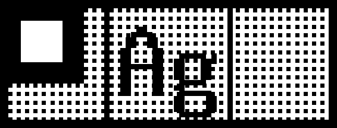

# sr5900p

A command-line interface and library for SR5900P tape printer.

This is a fork of [hikalium/sr5900p](https://github.com/hikalium/sr5900p).




```sh
# Install
make install

# Preview - preview.png will be generated after each commands:
sr5900p print --dry-run --width 36 --test-pattern
sr5900p print --dry-run --width 12 --test-pattern
sr5900p print --dry-run --width 12 --qr-text 'Hello, world!'
sr5900p print --dry-run --printer ${PRINTER_IP} --qr-text 'Hello, world!' # width auto detect

# Detect your printer's IP with avahi-browse:
sudo apt-get install -y avahi-utils
PRINTER_IP=`avahi-browse -alrpt | grep -E '^=.*SR5900P' | cut -d ';' -f 8`

# OR, you can manually set the IP:
PRINTER_IP=${YOUR_PRINTER_IP}

# Let's print! (RUST_LOG=debug also shows the status read before printing)
sr5900p print --printer ${PRINTER_IP} --test-pattern
sr5900p print --printer ${PRINTER_IP} --qr-text 'Hello, world!'
```

## Label templates

A template (TOML) lays out text / QR code / image columns from left to right.
Text is rendered with TTF/OTF fonts, so Japanese text and multiple fonts and sizes are supported.
A label longer than the template's `max_length_mm` is rejected instead of printed.
See `src/label/template.rs` for the format and `templates/` for examples.

```sh
sr5900p print --dry-run --width 12 --template templates/shelf.toml \
  --field dept=開発部 --field shelf_id=SH-A03
```

From Rust (the `cli` feature only builds the command, so library users can turn it off):

```toml
[dependencies]
sr5900p = { git = "https://github.com/uzuna/sr5900p", default-features = false }
```

```rust,no_run
use sr5900p::label::{template::Template, LabelData, Renderer};
use sr5900p::printer::Printer;
use sr5900p::Tape;
use std::time::Duration;

fn main() -> Result<(), sr5900p::Error> {
    // load the template and its fonts once, then render as many labels as needed
    let renderer = Renderer::new(Template::load("templates/shelf.toml")?)?;
    let label = renderer.render(
        &LabelData::new().text("dept", "開発部").text("shelf_id", "SH-A03"),
        Tape::W12,
    )?;
    std::fs::write("preview.png", label.to_png()?).expect("write preview.png");
    Printer::new("192.168.11.16".parse().unwrap())
        .timeout(Duration::from_secs(5))
        .print(&label)?;
    Ok(())
}
```

Errors are typed (`label::error::LabelError`, `printer::PrinterError`, or `sr5900p::Error` for both),
and every network wait is bounded by `Printer::timeout` / `Printer::print_timeout`.

## License
MIT

## Author
hikalium (original author)

## Special Thanks
hikalium (for [the original implementation](https://github.com/hikalium/sr5900p) this fork is based on)
Mine02C4 (for [the initial analysis of the protocol](https://github.com/Mine02C4/TEPRA_PRO_SR5900P_analysis) )
